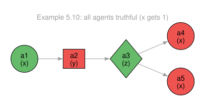
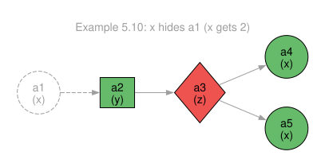
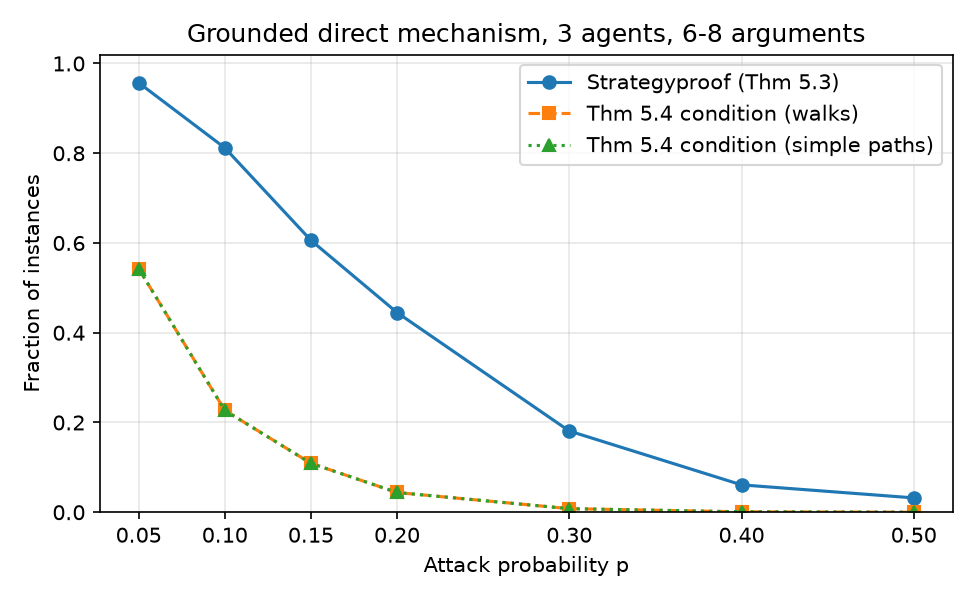

# Argumentation Engine

[](https://github.com/SreenityaThatikunta/argumentation-engine/actions/workflows/ci.yml)


A Python library for **abstract argumentation** and **strategic argumentation**.
It computes which arguments a rational agent should accept in a debate, and it
analyses whether self-interested agents can manipulate the outcome by hiding
arguments.

The project combines formal logic (Dung-style argumentation semantics) with
game theory (mechanism design and strategyproofness). It then tests a published
theorem empirically through large-scale simulations.

---

## Overview

**Reasoning engine.** Models a debate as a directed graph of arguments and
attacks. Computes the standard acceptability semantics:

- grounded
- complete
- preferred
- stable
- semi-stable

It also generates every legal in/out/undec labelling and classifies each
argument as skeptically accepted, credulously accepted, or rejected.

**Strategic analysis.** Models multiple agents that each hold private arguments
and choose what to reveal to a judge, the *grounded direct argumentation
mechanism*. The engine:

- finds each agent's best responses
- verifies strategyproofness exhaustively
- checks a graph-theoretic sufficient condition for strategyproofness, which
  requires parity-aware path search on cyclic graphs

**Experiments.** Generates thousands of random multi-agent instances and
measures how often truthful revelation is optimal. It also identifies the
cases where the theoretical condition and actual behaviour disagree.
An exhaustive search then checks the theorem on every graph with up to 5
arguments, over 200 million cases in total.

**Visualisation.** Renders frameworks and mechanism outcomes with Graphviz,
coloured by labelling, showing which arguments each agent withheld.

## Getting Started

```bash
git clone https://github.com/SreenityaThatikunta/argumentation-engine.git
cd argumentation-engine
python3 -m venv .venv && source .venv/bin/activate
pip install -e ".[dev]"
pytest
```

```python
from argumentation import (
    ArgumentationFramework, acceptance_status, grounded,
    legal_labellings, preferred_extensions,
)

# a1 and a2 attack each other; a3 is unattacked
af = ArgumentationFramework(["a1", "a2", "a3"], [("a1", "a2"), ("a2", "a1")])

af.is_conflict_free({"a1", "a3"})   # True
af.characteristic({"a3"})           # F(S) = {a3}
grounded(af)                        # {a3}
preferred_extensions(af)            # [{a1, a3}, {a2, a3}]
legal_labellings(af)                # 3 in/out/undec labellings
acceptance_status(af, "a1")         # credulously accepted (preferred semantics)
```

### Strategic argumentation

```python
from argumentation.examples import example_5_10
from argumentation.strategic import Game, mechanism, satisfies_theorem_5_4

attacks, types = example_5_10()   # agents x, y, z with private arguments
mechanism(attacks, types)         # truthful outcome: {a1, a3}

game = Game(attacks, types)
game.best_responses("x", {"y": types["y"], "z": types["z"]})
# BestResponses(utility=2, reports=[{a4, a5}])  -> x gains by hiding a1
game.is_strategyproof()                  # False (exhaustive Theorem 5.3 check)
satisfies_theorem_5_4(attacks, types)    # False (a1 indirectly defeats a4, a5)
```

### Visualisation

```python
# continues the example above
from argumentation.visualize import mechanism_dot, render

hiding = {**types, "x": types["x"] - {"a1"}}
render(mechanism_dot(attacks, types, hiding), "x_hides_a1.svg")   # needs Graphviz
```

Arguments are coloured by label (in = green, out = red, undec = grey), each
agent gets its own node shape, and withheld arguments are dashed. Example 5.10,
where agent x gains by hiding α1:

| All agents truthful (x gets 1) | x hides a1 (x gets 2) |
|---|---|
|  |  |

More figures are in [`docs/figures/`](docs/figures/); regenerate them with
`python experiments/figures.py`.

## Demo

```bash
python demo.py              # guided walkthrough, pauses between sections
python demo.py --no-pause   # run straight through
python demo.py --section 3  # one section only
```

A terminal walkthrough of the whole project on the textbook examples, which
takes a few minutes to present:

1. **Framework basics** on Figure 5.1: conflict-freeness, defence, F(S) iterated to the grounded extension, admissible vs complete
2. **Semantics** on Figure 5.2: all five semantics, the three labellings, acceptance status, and an edge case where semi-stable differs from preferred
3. **Example 5.10**: the truthful outcome and utilities, x's best response (hide α1), and the Theorem 5.3 and 5.4 checks
4. **Example 5.11**: strategyproof even though the Theorem 5.4 condition fails
5. **Cycles**: a graph where walks and simple paths disagree
6. **Experiments**: a live mini-run, the full results table, and one explained instance for each Q3 reason
7. **Exhaustive verification**: a live check up to 4 arguments, plus the saved results up to 5

The two textbook misprints are pointed out where they occur. Figures are written to `demo_output/`.

## Experiments

```bash
pip install -e ".[experiments]"
python experiments/run_experiments.py --instances 1000 --out results
```

Generates 1000 random instances per attack probability *p*: 3 agents, 6–8
arguments, each attack present with probability *p*, and arguments split at
random among the agents. For each instance the runner records whether the
mechanism is strategyproof and whether Theorem 5.4's condition holds. Output
goes to [`results/`](results/).



| p | Strategyproof | Thm 5.4 condition holds | Condition holds, not strategyproof | Strategyproof, condition fails |
|---|---|---|---|---|
| 0.05 | 95.7% | 54.3% | 0 | 414 |
| 0.10 | 81.2% | 22.7% | 0 | 585 |
| 0.15 | 60.6% | 10.9% | 0 | 497 |
| 0.20 | 44.5% | 4.4% | 0 | 401 |
| 0.30 | 18.1% | 0.8% | 0 | 173 |
| 0.40 | 6.1% | 0.1% | 0 | 60 |
| 0.50 | 3.2% | 0.0% | 0 | 32 |

Key findings:

- **No counterexamples to Theorem 5.4.** Not one of the 7000 instances
  satisfies the condition and still fails strategyproofness. This holds
  whether "odd-length path" counts walks or only simple paths.
- **The condition is far from necessary.** Most strategyproof instances fail
  it. In 98% of those, hiding arguments *can* rescue an indirectly defeated
  argument, but every such deviation loses at least as many of the agent's own
  arguments as it saves. The rest are cases where the odd path is always
  cancelled (as in the book's Example 5.11), or where the only violation is an
  odd cycle through a single argument.
- **Allowing self-attacks** ([`results/self-attacks/`](results/self-attacks/))
  lowers strategyproofness at low p (81.2% → 72.7% at p = 0.1) but raises it
  at high p (3.2% → 9.5% at p = 0.5). It still produces no counterexamples.

### Exhaustive verification

```bash
python experiments/exhaustive.py --max-n 5 --out results/exhaustive
python experiments/exhaustive.py --max-n 5 --self-attacks --out results/exhaustive-self-attacks
```

Random sampling can miss rare cases, so this script checks **every** directed
graph on up to 5 arguments against **every** possible argument set for an
agent. Agent types don't overlap, so the other agents together can reveal any
subset of the remaining arguments. Strategyproofness therefore depends only on
the graph and the agent's own set. The search uses a bitmask engine that is
cross-checked against the main library and runs in parallel.

| Graphs | (graph, agent set) pairs checked | Condition holds, not strategyproof |
|---|---|---|
| No self-attacks, n ≤ 5 | 6,312,206 | **0** (walks), **0** (simple paths) |
| With self-attacks, n ≤ 5 | 201,656,372 | **0** (walks), **0** (simple paths) |

Theorem 5.4 has no counterexample up to 5 arguments. The less restrictive
**simple-path** reading also never fails, even though it accepts more cases
than the walk reading: 33,549 extra (graph, agent set) pairs at n = 5, every
one of them strategyproof. On these sizes, the simple-path condition is still
sufficient and identifies more strategyproof cases.

## Roadmap

- [x] Argumentation framework: conflict-freeness, defence, characteristic function
- [x] Admissible and complete set checks
- [x] Grounded, complete, preferred, stable and semi-stable extensions
- [x] Labelling enumeration and argument acceptance status
- [x] Grounded direct argumentation mechanism and best-response search
- [x] Strategyproofness verification (Theorem 5.3) and graph condition (Theorem 5.4)
- [x] Randomised experiments with results and plots
- [x] Test suite built from textbook examples
- [x] CI with linting, type checking and coverage
- [x] Exhaustive verification of Theorem 5.4 on small graphs
- [x] Graphviz visualisation
- [x] Demo walkthrough
- [x] Written report

See [docs/ROADMAP.md](docs/ROADMAP.md) for planned extensions.

## Project Structure

```
argumentation/            # the library
  framework.py            #   ArgumentationFramework: conflict-free, defence, F(S), admissible, complete
  semantics.py            #   grounded, complete, preferred, stable, semi-stable
  labelling.py            #   in/out/undec labellings
  acceptance.py           #   skeptical / credulous / rejected
  strategic.py            #   mechanism, best responses, Theorems 5.3 and 5.4
  visualize.py            #   Graphviz rendering
  examples.py             #   graphs from the textbook
experiments/
  run_experiments.py      # random-instance experiments
  exhaustive.py           # exhaustive verification on small graphs
  figures.py              # renders docs/figures/
demo.py                   # guided walkthrough of the whole project
tests/                    # pytest suite, built from textbook examples
results/                  # experiment outputs (CSV, JSON, plots)
docs/                     # specification, roadmap, figures
report/                   # LaTeX report and its figures
```

## Development

```bash
pip install -e ".[dev,experiments]"
ruff check . && ruff format --check .   # lint and formatting
mypy                                    # type checking
pytest --cov=argumentation              # tests with coverage
```

## Documentation

- [Report (PDF)](report/report.pdf): 6-page write-up of the design, validation
  and experiment findings. Rebuild it with `cd report && latexmk -pdf report.tex`
  (figures: `python experiments/figures.py --format pdf --no-titles --plots --out report/figures`)
- [Project specification](docs/SPECIFICATION.md): full scope, definitions,
  validation cases, experiment design, and known textbook errata
- [Roadmap](docs/ROADMAP.md): improvements and research extensions

## Reference

I. Rahwan, "Argumentation among Agents," Chapter 5 in G. Weiss (ed.),
*Multiagent Systems*, 2nd ed., MIT Press, 2013.

## License

Released under the [MIT License](LICENSE).
